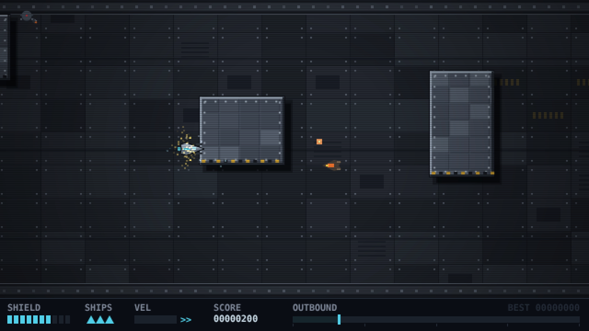

# Rivets 'n Ruin

A side-scrolling shoot 'em up in the lineage of **Uridium** (skim the surface of a
capital ship, two-way scrolling, momentum-heavy handling) and **Jets'n'Guns**
(mercenary swagger, things exploding at a generous rate).

You fly the dorsal hull of a dreadnought end to end — then you have to fly it
back. The hull is solid. Hitting it costs you.



## Running it

```bash
make run
```

Then open <http://localhost:8000>. One process serves both the game and the
backend API, so there is one thing to run and no CORS to think about.

`make` on its own lists every target. The useful ones:

| Target | Does |
| --- | --- |
| `make run` | Game + backend. `ADDR=0.0.0.0:8000 make run` to expose it |
| `make check` | Everything CI would: gofmt, vet, race tests, JS syntax |
| `make test` / `test-race` | Go tests |
| `make build` / `dist` | Binary / self-contained release tree |
| `make icons` | Regenerate the favicon |

Server flags: `-addr`, `-dir`, `-data`, `-save-interval`, `-rate-limit`,
`-rate-burst`, `-v`.

> **A note on `node --check`.** It reports success on a `.js` file containing ES
> module syntax even when the file is genuinely unparseable — it only diagnoses
> correctly when the extension is `.mjs`. Every client module here is ESM in a
> `.js` file, so checking them directly is a gate that cannot fail. `make
> js-check` copies to `.mjs` first. If you add your own check, do the same.

The game has no build step and no client dependencies — plain ES modules and
canvas. The server is Go stdlib only. **The game is fully playable with the
backend down**; you lose the leaderboard, not the game.

## Controls

| Key | Action |
| --- | --- |
| `←` `→` / `A` `D` | Horizontal thrust. Thrusting against your heading brakes, then flips the ship |
| `↑` `↓` / `W` `S` | Vertical thrust |
| `Z` / `Space` | Fire |
| `Enter` | Launch / restart |
| `P` / `Esc` | Pause |
| `M` | Mute / unmute |
| `T` | Next tune |
| `N` | Rename your pilot (title screen) |
| `R` | Restart mid-run |

## The run

Three hulls, flown back to back. Each one is longer, denser and better defended
than the last, and each is named for a metal — Uridium's stage-naming ritual.

| Hull | Length | Turret HP | Interceptors | Tune |
| --- | --- | --- | --- | --- |
| **ARGENTUM** — patrol hull | 12,000px | 3 | 172px/s, every 1.5s | DROSS |
| **OSMIUM** — line hull | 14,500px | 4 | 196px/s, every 1.2s | QUENCH |
| **TANTALUM** — flagship hull | 17,000px | 5 | 220px/s, every 0.98s | OVERDRIVE |

On each hull: fly to the far end, turn around, fly back to the dock. Both legs
scores a time bonus. Dying out of ships ends the run wherever you are.

### The refit

Clearing a hull permanently upgrades the ship for the rest of the run, so the
difficulty curve is met with a power curve rather than just better flying:

| | Per hull cleared |
| --- | --- |
| Shield maximum | +45 |
| Acceleration | ×1.09 |
| Top speed | +24 horizontal, +18 vertical |
| Muzzle velocity | +50 |
| Gun mounts | +1 to the **cap** on both gunspeed and gunblaze |
| Guns | +1 free level of each |
| Hangar | +1 ship |

By TANTALUM you are flying a markedly different craft from the one that
launched: 190 shield, 19% more thrust, five gun mounts. Everything is held on
the player object rather than mutating shared config, so a restart genuinely
gives you a stock ship.

## What's in this slice

- **Momentum handling.** Low horizontal drag so you coast; high vertical drag so
  you can place the ship precisely. Reverse thrust brakes hard, then flips the
  ship through a scale-through-zero animation — the Uridium move.
- **Bidirectional scrolling** with facing-based camera lead, so reversing slides
  the whole world across and you always see where you're going.
- **12,000px of procedurally generated hull**, deterministic from `LEVEL_SEED`.
  Six obstacle patterns — towers, pincers, free-standing pillars, stepped stacks
  — each guaranteed to leave a navigable corridor.
- **Two attack patterns.** Hull turrets (static, 3 HP, arc-limited tracking,
  lead-aimed 3-round bursts) and interceptors (spawn ahead of your heading, close
  on a homing sine weave, fire aimed shots).
- **Hull collision** with per-axis resolution and speed-proportional shield
  damage. A full-speed slam costs ~16 of 100; brushing it costs ~3.
- Pre-rendered riveted plating, cast shadows, hazard chevrons on every surface
  that points into the playfield, particle explosions, screen shake, CRT
  scanlines and vignette.
- **Fully procedural audio** — see below.

## Pickups

Everything you destroy can drop one, so shooting pays beyond score and a long
run gets genuinely stronger rather than just longer. Turrets drop at 60%,
interceptors at 17%. Each is worth 50 points on top of its effect.

| Pickup | Colour | Effect |
| --- | --- | --- |
| **shields-refill** | cyan | Restores 40 shield |
| **lifesavers** | pale cyan | +1 ship, to a maximum of 6 |
| **healthbars** | green | Raises **maximum** shield by 25 (to 220) and grants it |
| **gunspeed** | yellow | Shorter fire interval — ×1 → ×0.76 → ×0.58 → ×0.44 |
| **gunblaze** | orange | Adds a mirrored pair of angled barrels per level: 2 → 4 → 6 → 8 shots a volley |

`shields-refill` and `healthbars` are deliberately different: one tops up the
bar, the other extends it. Both read at a glance because the HUD label switches
to `SHIELD 125` in green once your ceiling has moved.

Guns cap at level 3 each; collecting at max converts to points instead. **Dying
costs one level off each gun** — enough to feel, not enough to undo a whole
run's worth of pickups.

Each pickup carries a glyph as well as a colour, because colour alone fails for
anyone who can't separate the cyan from the green, and these appear against a
busy hull at speed. They bob, drift, pull toward you slightly within 38px so a
near miss at full throttle still counts, and flash for their last three seconds
before expiring. A drop that would land inside solid hull is relocated to open
space, so a pickup is never unreachable.

## Audio

Every sound is synthesised at runtime from oscillators and noise. There are no
audio files to load, nothing to license, and the whole system is about 400 lines.
It also happens to be the right register: both reference games came out of an era
when the music *was* the synthesiser.

**14 effects**, each built from a pitch sweep plus a filtered noise burst. Hull
contact is the one worth calling out — its brightness and pitch track impact
speed, so a graze and a full-tilt slam are audibly different and you learn the
damage model through your ears before you read the shield bar.

**An adaptive score** in D phrygian at 152 BPM — galloping bass, kick/snare/hats,
an arpeggio lead and a detuned pad, sequenced on a 16th grid over a four-bar
`i – bII – i – bVII` progression. Four intensity layers, driven by what is
actually happening:

| Layer | When |
| --- | --- |
| 0 — pad and sparse arp | title and end screens |
| 1 — drums and bass enter | reserved for calm stretches |
| 2 — full kit, arpeggio lead | in flight |
| 3 — doubled lead, 16th hats | return run, or shield below 30 |

Intensity changes land on a bar line, so layers never pop in mid-phrase.

Sequencing uses the Web Audio lookahead pattern — a 25ms timer schedules every
step falling inside the next 120ms against `ctx.currentTime`. Driving it from
`requestAnimationFrame` instead would jitter audibly, because rAF is tied to the
display and the audio clock is not.

### Tunes

Four of them. `T` cycles; each hull also selects its own, so the score tracks
where you are in the campaign unless you override it.

| Tune | Character |
| --- | --- |
| **DROSS** | D phrygian, 152 BPM — the default driver |
| **QUENCH** | A aeolian, 126 BPM, half time — lower, heavier |
| **OVERDRIVE** | E dorian, 174 BPM, double time — relentless |
| **VACUUM** | D aeolian, 104 BPM — sparse, drifting |

A tune is pure data in `TUNES` in `src/music.js`: tempo, root, mode, chord
movement, drum masks and lead shape. Adding a fifth is adding an entry, not
code. Switches land on the next bar line so a change never chops a phrase in
half, but the UI reports your selection immediately rather than waiting.

Audio cannot start before a user gesture (browsers forbid it), so the context is
created on your first keypress. Mute is `M`; both it and your tune choice
persist across reloads.

## Backend

A Go service keeping high scores, top lists, mods and live presence.

**On "multiple players at the same time":** everyone flies their own run and the
shared state is the score board, not the game world. There is no netcode, no
shared physics and no live opponents on your hull. What *is* shared, and live,
is who is currently flying — the status bar shows the count, and `/api/presence`
reports each pilot's progress along the hull.

### Endpoints

| Method | Path | Auth | Purpose |
| --- | --- | --- | --- |
| `GET` | `/api/health` | — | liveness |
| `GET` | `/api/stats` | — | players, runs, mods, who is flying |
| `POST` | `/api/players` | — | register; returns a bearer token **once** |
| `GET` | `/api/players/{id}` | — | profile and recent runs |
| `GET` | `/api/me` | yes | your own profile |
| `POST` | `/api/scores` | yes | submit a run; returns your new rank |
| `GET` | `/api/scores/top` | — | leaderboard — `?mod=`, `?window=day\|week\|all`, `?limit=` |
| `GET` | `/api/mods` | — | list mods — `?sort=plays\|name\|new` |
| `POST` | `/api/mods` | yes | publish a mod |
| `GET` | `/api/mods/{id}` | — | one mod, with its config |
| `GET` | `/api/mods/{id}/top` | — | that mod's leaderboard |
| `POST` | `/api/presence` | yes | heartbeat while flying |
| `GET` | `/api/presence` | — | who is flying right now |

### High scores persist against your pilot, not your browser

The backend owns your best score, so it follows the pilot across machines and
survives a cleared `localStorage`. The browser keeps a cached copy purely so a
number still shows when the backend is unreachable. On connect the two are
reconciled and the higher wins.

### Identity

Registration mints a 256-bit bearer token and the server stores only its
SHA-256. The client keeps the token in `localStorage`. There are no passwords
and no email — that is the right weight for a score board, and it means a
leaked snapshot file hands over nobody's identity. Renaming mints a fresh
identity; the old name keeps its scores.

### Mods

The game is already fully determined by a hull seed plus the values in
`src/config.js`, so a mod is exactly those two things:

```bash
curl -X POST localhost:8000/api/mods -H "Authorization: Bearer $TOKEN" -d '{
  "name": "Osmium Drift",
  "seed": 99887766,
  "config": {"SHIP": {"maxVX": 420, "dragX": 0.9}, "INTERCEPTOR": {"spawnEvery": 0.8}},
  "notes": "Denser traffic, looser ship."
}'
```

Play one at `/?mod=<id>`. Its scores go to its own leaderboard, never the stock
one. Overrides are applied against an allowlist (`SHIP`, `TURRET`,
`INTERCEPTOR`, `CAM`, `COL`) with type checking, so a mod can retune the game
but cannot reach into anything structural and break it.

### Leaderboards

One row per player — their best run in the bucket, not their best ten. Ties
break toward the faster run, then the earlier one. Buckets are per-mod and
per-window (day, week, all time).

### Score validation — read this before trusting a number

`internal/validate` derives bounds from the game's own physics. The hull is
12,000px, top speed is 310px/s, so a full out-and-back cannot be flown in under
**73.9 seconds** — any faster "completed" run is rejected outright. Point totals
are checked against a ceiling computed from the run's duration and the scoring
rules.

The campaign is modelled hull by hull, including the fact that the ship gets
faster with each refit — a later hull can legitimately be flown quicker than the
first, and a bound that ignored that would reject honest runs. Three hulls out
and back cannot be done in under **249 seconds**.

**These are plausibility bounds, not anti-cheat.** They stop someone curling a
score of 10⁹ onto the board. They do not stop anyone who reads the rules and
submits a number just under the ceiling. Real anti-cheat means submitting an
input trace and re-simulating it server-side against the same seed — the game is
deterministic from `LEVEL_SEED` and a fixed timestep, so that is achievable, but
it is a separate piece of work and it is not done here.

### Storage

An in-process store behind a `Store` interface, snapshotted to JSON (written to
a temp file and renamed, so a crash cannot truncate your data). Periodic saves
plus a final one on `SIGTERM`.

This is right for now and wrong later. It does not survive beyond one process,
so there is no horizontal scaling; everything is resident in memory; and top
lists sort on read rather than using an index. At a few hundred thousand scores
that stops being acceptable — the `Store` interface is there so swapping in SQL
is a contained change.

Rate limiting is a per-IP token bucket, which means players behind one NAT share
a bucket. Keying on the bearer token instead would let anyone mint unlimited
buckets by registering, so IP is the lesser evil; raise `-rate-limit` if real
players ever collide. It is not DDoS protection — that belongs in front of the
process.

## Layout

```
index.html        host page, canvas, integer upscaling
src/config.js     every tunable: physics, enemies, camera, palette
src/loop.js       fixed 120Hz timestep, free-running render
src/level.js      hull generation, collision buckets, pre-rendered plating
src/player.js     ship physics, flip, firing, hull collision response
src/enemies.js    turret and interceptor behaviour
src/game.js       state machine, collision pairs, scoring, run objective
src/render.js     world drawing
src/hud.js        HUD and the title / game-over / complete screens
src/pool.js       fixed-capacity object pools (no allocation during play)
src/audio.js      Web Audio graph, buses, voice limiting, synthesis primitives
src/sfx.js        the 14 sound effects
src/music.js      adaptive sequencer and its instrument voices
src/net.js        backend client; degrades to offline play
src/mods.js       mod loading and config overrides
src/projectiles.js src/particles.js src/camera.js src/rng.js src/input.js

Makefile          make, for the list of targets
tools/make_icons.py  regenerates favicon.ico
cmd/server/       the binary: static files + API
internal/model/   shared types
internal/store/   Store interface, in-memory implementation, snapshots
internal/api/     routing, handlers, auth, rate limiting
internal/validate/ score plausibility, derived from the game's physics
```

Run the Go tests with `go test ./...` (and `-race`, which the suite is clean
under — it covers concurrent submission and concurrent store access).

Everything you'd want to tune while playtesting lives in `src/config.js`. The
game object is exposed as `window.game` for poking at from the devtools console.

## Known gaps

These are deliberate omissions from the vertical slice, not bugs:

- **No upgrade shop.** The weapon-mount economy that drives Jets'n'Guns is the
  obvious next system — the single forward cannon is a placeholder for it.
- **No boss, no landing sequence.** Uridium ends each level with a landing
  minigame; the dock here is just a position.
- **The refit curve is unplayed.** Three hulls and the per-hull upgrades are
  first guesses; whether the ship outgrows the difficulty is exactly the thing
  only playing will tell you. All of it is in `LEVELS` and `LEVEL_UP` in
  `src/config.js`.
- **HUD text uses the system monospace font**, not a bitmap font, so it doesn't
  scale as crisply as the rest of the art.
- The hull texture is one 12000×324 offscreen canvas (~15MB). Fine at this
  length; chunked lazy tiles if the level grows much past it.
- **Score validation is not anti-cheat.** See the backend section above.
- **Pickup balance is unplayed.** Drop rates, the 40-point refill and the gun
  curves are first guesses; nobody has judged whether the run gets too strong
  too fast. They are all in `PICKUP` in `src/config.js`.
- **No mod browser in-game.** Mods are published over the API and played via
  `/?mod=<id>`; there is no UI for discovering them yet.
- **Single-process storage.** JSON snapshots, no SQL, no horizontal scaling.
- **No account recovery.** Lose the token in `localStorage` and that pilot's
  identity is gone, though their scores stay on the board.

## Licence

GPL-3.0
